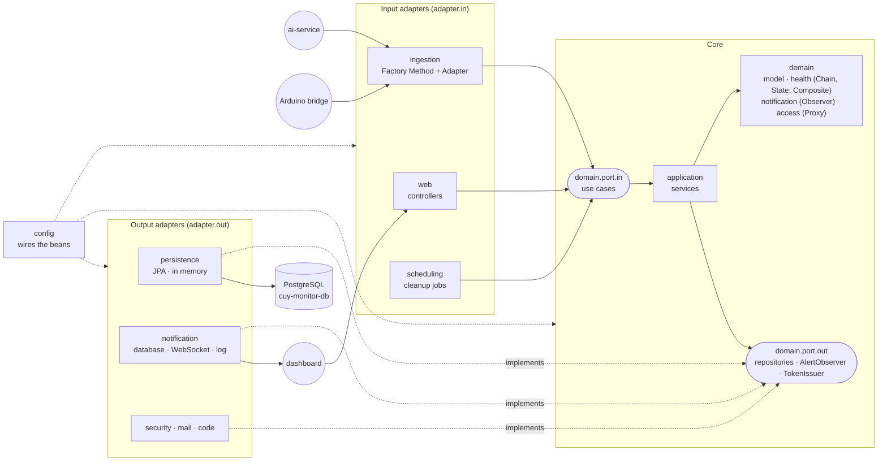
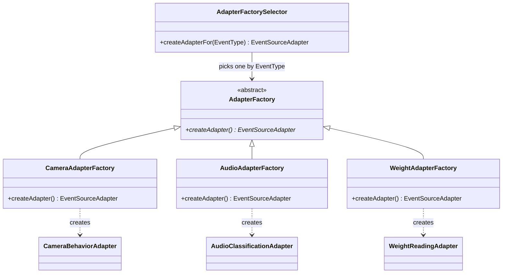
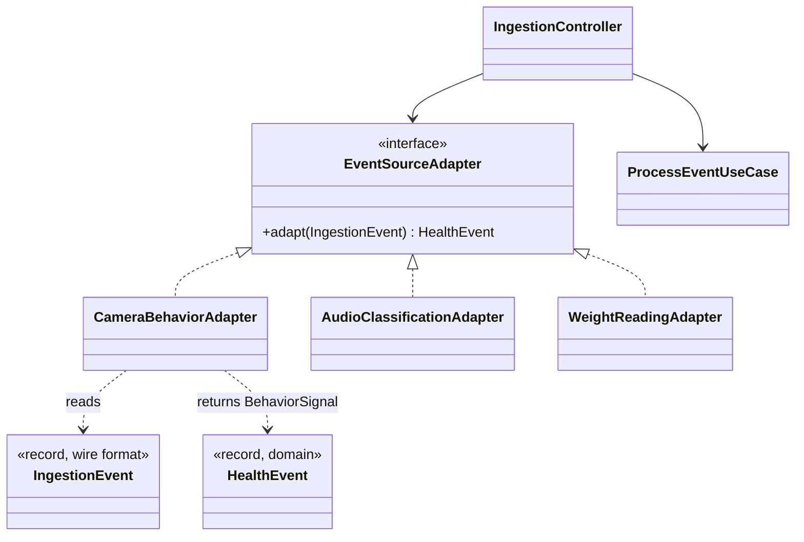
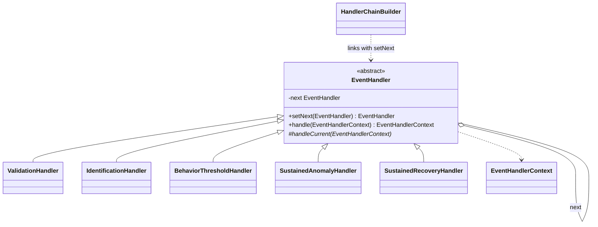
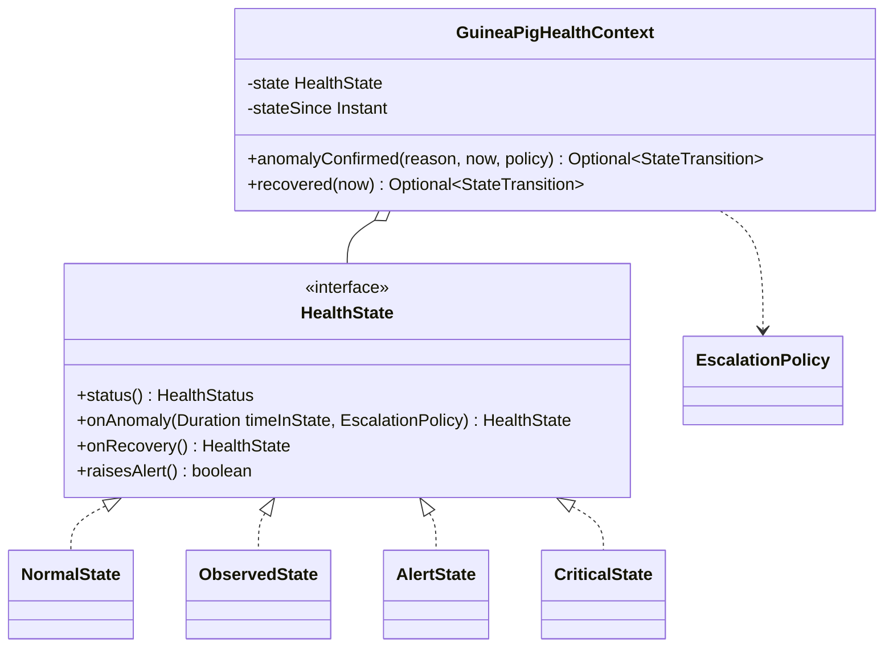
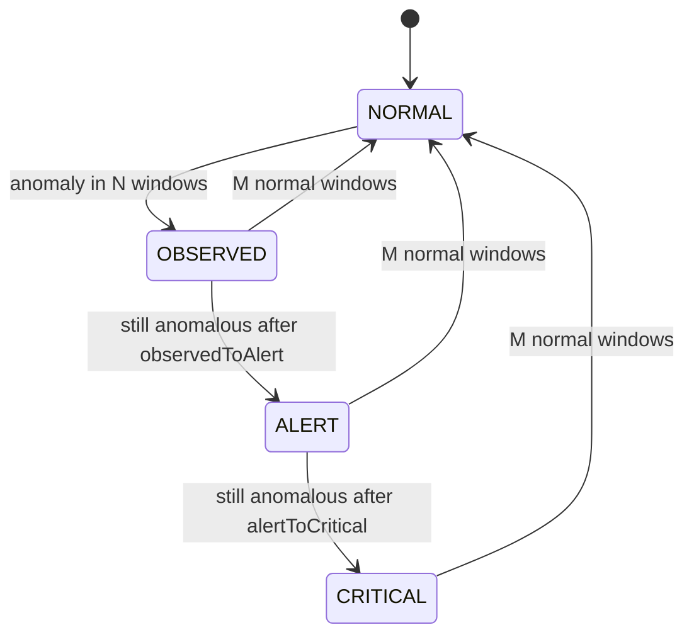
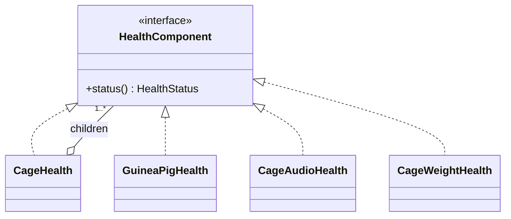
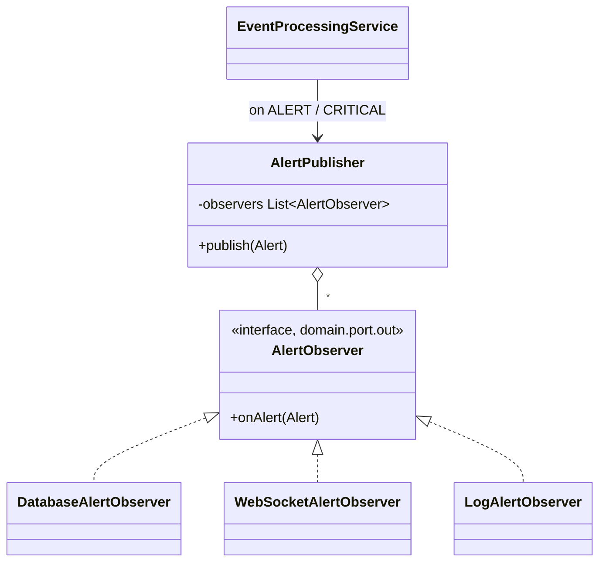
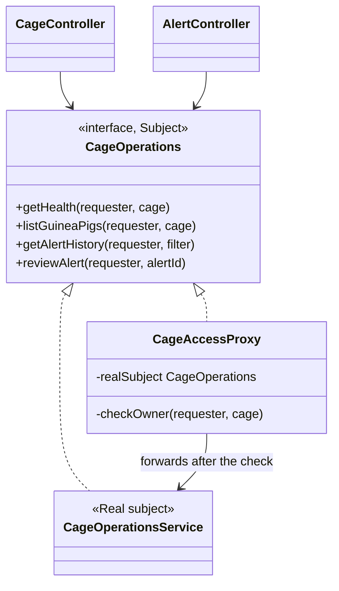
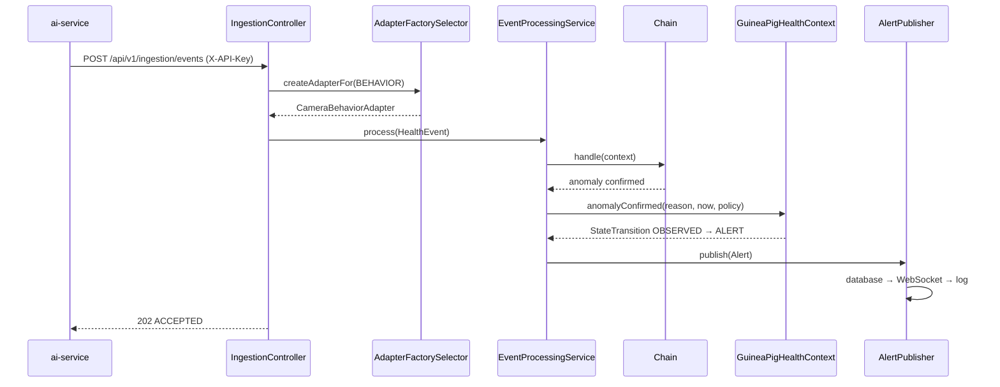

# Diagrams (Task 16.1)

Drawn with Mermaid, so GitHub renders them and they change in the same PR as the code. Class names are the
real ones; `HexagonalArchitectureTest` (ArchUnit) checks the dependency arrows of the first diagram on every build.

- [1. The hexagon](#1-the-hexagon)
- [2. Factory Method](#2-factory-method) · [3. Adapter](#3-adapter) · [4. Chain of Responsibility](#4-chain-of-responsibility)
- [5. State](#5-state) · [6. Composite](#6-composite) · [7. Observer](#7-observer) · [8. Proxy](#8-proxy)
- [9. One event, end to end](#9-one-event-end-to-end)

## 1. The hexagon

Arrows only point inwards: the core never imports an adapter, Spring or JPA.

## 2. Factory Method

The only `switch` on `EventType` chooses the factory; each factory creates its own product.

## 3. Adapter

The JSON of each producer (adaptee) becomes the one `HealthEvent` the core understands (target).

## 4. Chain of Responsibility

`ValidationHandler → IdentificationHandler → BehaviorThresholdHandler → SustainedAnomalyHandler → SustainedRecoveryHandler`.
Any handler can stop the chain (stale event, unknown guinea pig) by rejecting the context.

## 5. State

## 6. Composite

`CageHealth.status()` is the worst status of its children; the dashboard's traffic light reads only that.

## 7. Observer

The order (database first, so the alert has its id; then WebSocket; then the log) is written in `NotificationConfig`.

## 8. Proxy

Written by hand: no `@PreAuthorize`, no Spring AOP (also checked by ArchUnit).

## 9. One event, end to end

`HealthFlowIntegrationTest` runs exactly this path against a real Postgres.
